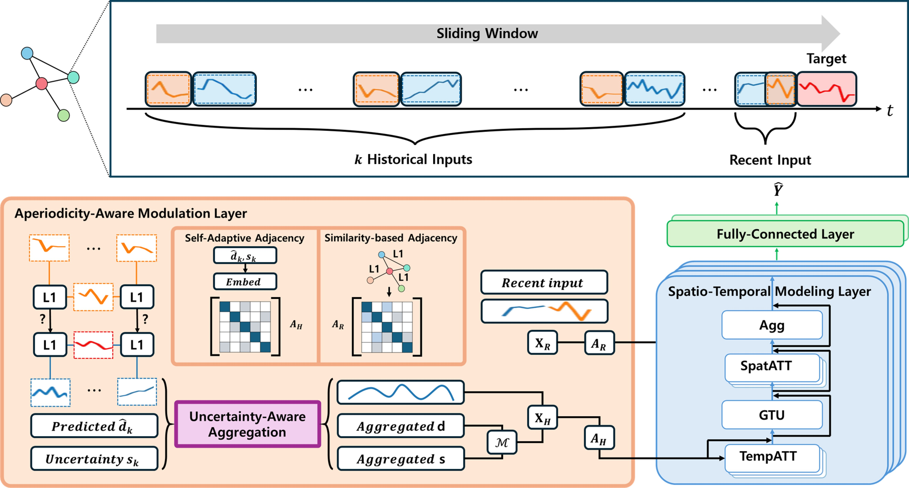

<h1 align="center">SIMBAD: Spatio-Temporal Traffic Forecasting Robust to Aperiodicity</h1>

<p align="center">
  <a href="https://arxiv.org/abs/2611.09015"></a>
  <a href="https://neurips.cc/Conferences/2026"></a>
</p>

<p align="center">
  <b>Daniel Y. Lee</b><sup>1</sup> · <b>Seungwon Shin</b><sup>1</sup> · <b>Seunghoon Han</b><sup>2</sup> · <b>Sungsu Lim</b><sup>2,†</sup> · <b>Susik Yoon</b><sup>1,†</sup></strong></p>
</p>

<p align="center">
  <sup>1</sup>Korea University, Seoul, South Korea &nbsp;&nbsp; <sup>2</sup>Chungnam National University, Daejeon, South Korea
</p>

<p align="center">
  <sup>†</sup>Corresponding authors
</p>

<p align="center">
  
</p>
<p align="center">
  <em>Traffic conditions do not always follow a fixed periodic pattern. To address this, SIMBAD selectively regulates and combines historical periodic information according to their similarity to current traffic pattern. It further leverages uncertainty to account for discrepancies between observed similarities and future traffic dynamics, reducing the influence of unreliable historical patterns.</em>
</p>

# Abstract
Accurate traffic prediction is essential for urban planning but remains challenging due to the irregular patterns caused by unexpected events. While Spatio-Temporal Graph Neural Networks (STGNNs) effectively model periodic data, they often struggle with these aperiodic fluctuations. To address this, we propose SIMBAD, which improves generalization on irregular patterns via two key mechanisms: 1) adaptive regulation of periodic signals to prioritize recent signals, and 2) dynamic spatial modeling that adjusts influence between connected nodes based on contextual relations. Built upon simple similarity metrics to adapt to aperiodic patterns, SIMBAD outperforms existing methods on real-world benchmark datasets, demonstrating superior performance in predicting unseen and irregular traffic events.

# Project structure

```text
.
├── assets/                 # Architecture figure
├── config/                 # Dataset and training configurations
├── data/                   # Traffic signals and connectivity information
├── Run.py                  # Training and evaluation entry point
├── SIMBAD.py               # SIMBAD architecture
├── data_preparation.py     # Window generation and normalization
├── uncertainty.py          # Similarity and uncertainty modules
├── metric.py               # MAE, RMSE, and MAPE metrics
└── utils.py                # Scaling, logging, and graph utilities
```

# Training

Run training from the project root by passing a configuration file:

```bash
python Run.py \
  --config config/PEMS03.conf \
  --checkpoint PEMS03.pth \
  --log PEMS03.log
```

# Evaluation

Evaluate an existing checkpoint with the same dataset configuration used for training:

```bash
python Run.py \
  --config config/PEMS03.conf \
  --checkpoint PEMS03.pth \
  --log PEMS03_test.log \
  --mode test
```

# Dataset
## Main

We used four traffic datasets PEMS03, PEMS04, PEMS07 and PEMS08 which are collected by California Transportation Agencies (CalTrans) Performance Measurement System (PeMS).

Traffic and connectivity information for PEMS03, 04, 07 and 08 can be downloaded from [ASTGNN](https://github.com/guoshnBJTU/ASTGNN/tree/main/data).

## Additional Dataset 1

We used METR-LA and PEMS-BAY which are collected from loop detectors deployed on highways in Los Angeles County and the Bay Area, respectively.

Traffic information for PEMS-BAY and METR-LA can be downloaded from [STAEformer](https://github.com/XDZhelheim/STAEformer).

## Additional Dataset 2

We also evaluated SIMBAD on SD, a large-scale San Diego subset of LargeST containing traffic measurements collected by Caltrans PeMS.

Traffic information for SD can be downloaded from [LargeST](https://github.com/liuxu77/LargeST).

## Data Format

Each dataset should be stored under `data/<DATASET>/` and requires two files:

```text
data/<DATASET>/
├── <DATASET>.npz
└── <DATASET>.csv
```

## Dataset Statistics
| Dataset | PEMS03 | PEMS04 | PEMS07 | PEMS08 | METR-LA | PEMS-BAY| SD (2019)|
|---------|--------|--------|--------|--------|--------|--------|--------|
| # of nodes | 358 | 307 | 883 | 170 | 207 | 325 | 716 |
| # of timesteps | 26,208 | 16,992 | 28,224 | 17,856 | 34,272 | 52,116 | 35,040 |
| Granularity | 5 mins | 5 mins | 5 mins | 5 mins | 5 mins | 5 mins | 15 mins |
| Start time | Sept. 1st 2018 | Jan. 1st 2018 | May 1st 2017 | July 1st 2016 | March 1st 2012 | Jan. 1st 2017 | Jan. 1st 2019 |
| End time | Nov. 30th 2018 | Feb. 28th 2018 | Aug. 31st 2017 | Aug. 31st 2016 | June 30th 2012 |  May 31st 2017 | Dec. 31st 2019 |
| Signals | F | F,S,O | F | F,S,O | F,S,O | F,S,O | F |

In row titled “Signals”, **F** represents traffic flow, **S** represents traffic speed, and **O** represents traffic occupancy rate.
